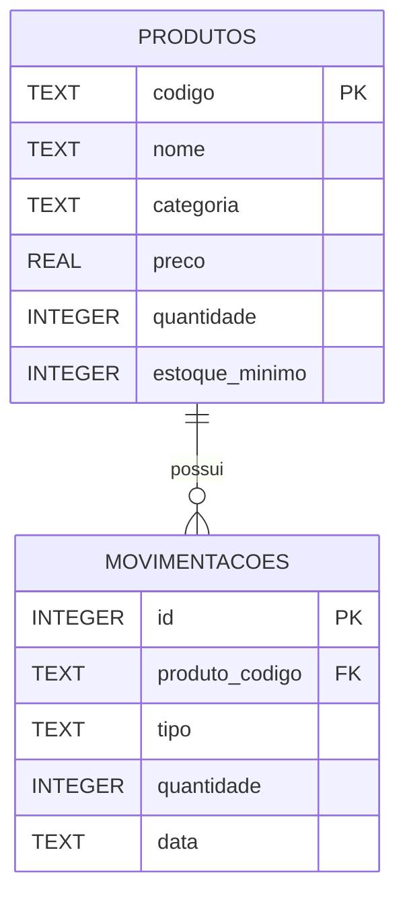

# Estoque Fácil

Sistema desktop de controle de estoque desenvolvido em Python, com interface gráfica Tkinter e persistência local em SQLite. Não é necessário instalar bibliotecas de terceiros.

## Funcionalidades

- Cadastro, edição e exclusão de produtos com código único, nome, categoria, preço e estoque mínimo.
- Registro de entradas e saídas com atualização automática do saldo pelo SQLite.
- Proteção contra saídas acima do estoque disponível e quantidades inválidas.
- Consulta do estoque com filtro por categoria, valor por produto e alertas de estoque baixo.
- Histórico de movimentações com filtro por categoria.
- Relatório visual por categoria com indicadores de produtos, unidades, valor total e itens em estoque baixo.
- Exportação do estoque (ou da categoria selecionada) para CSV, compatível com planilhas.
- Banco criado automaticamente na primeira execução. O caminho pode ser personalizado com `ESTOQUE_DB_PATH`.

## Requisitos

- Python 3.9 ou superior.
- Tkinter (normalmente incluído na instalação padrão do Python).

## Como executar

No terminal, na pasta do projeto:

```bash
python main.py
```

Também é possível iniciar com `python estoque_gui.py`. O arquivo `estoque.db` será criado na pasta do projeto. Para usar outro local, configure a variável de ambiente `ESTOQUE_DB_PATH` antes de iniciar.

## Testes

Execute os testes automatizados com:

```bash
python -m unittest discover -v
```

Os testes utilizam bancos temporários e não alteram o banco de dados do aplicativo.

## Estrutura do projeto

```text
.
├── banco.sql                 # Tabelas, índices e triggers do SQLite
├── main.py                   # Ponto de entrada
├── estoque_gui.py            # Inicialização da interface
├── estoque/
│   ├── database.py           # Conexão e inicialização do banco
│   ├── produtos.py           # CRUD, consulta e indicadores
│   ├── movimentacoes.py     # Entradas, saídas e histórico
│   ├── validacoes.py         # Validação de campos e quantidades
│   ├── exportacao.py         # Exportação CSV
│   └── interface.py          # Navegação e telas Tkinter
└── tests/
    └── test_estoque.py       # Testes de regras e relatórios
```

## Modelo do banco de dados



`produtos.codigo` é a chave primária. `movimentacoes.produto_codigo` referencia o produto e impede sua exclusão quando há histórico. A trigger `movimentacao_atualiza_estoque` atualiza a quantidade após cada movimentação; a trigger `movimentacao_saida_com_estoque` impede saldo negativo.

## Uso básico

1. Abra a aba **Produtos** e cadastre os produtos.
2. Na aba **Movimentações**, registre compras como entrada e vendas/uso como saída.
3. Consulte saldos e alertas em **Estoque atual**; use o filtro de categoria ou exporte CSV.
4. Consulte o histórico completo e os indicadores visuais nas abas correspondentes.
